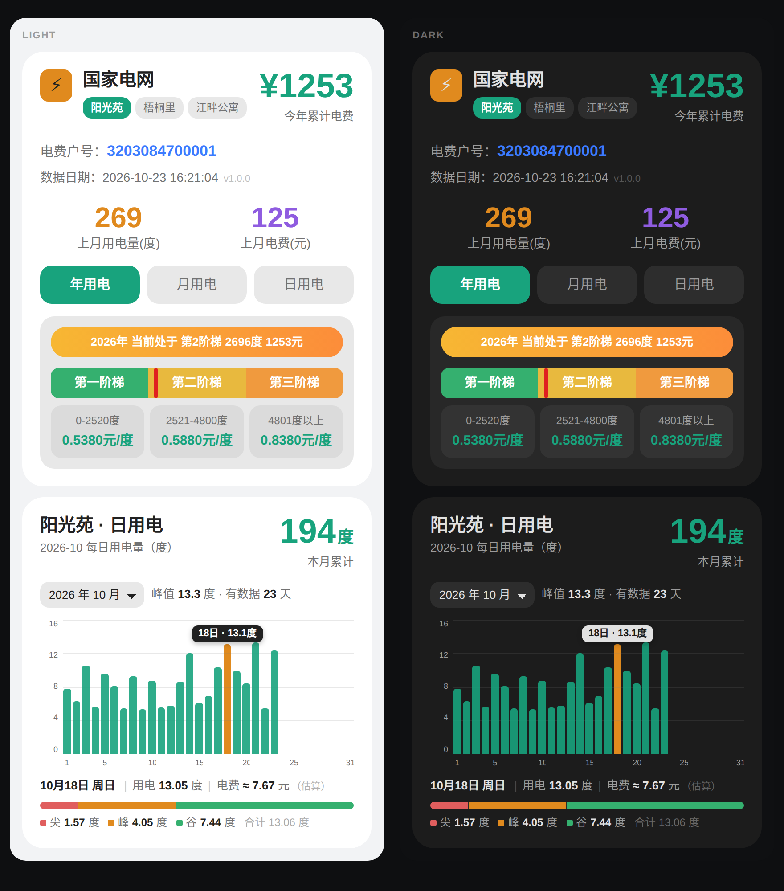
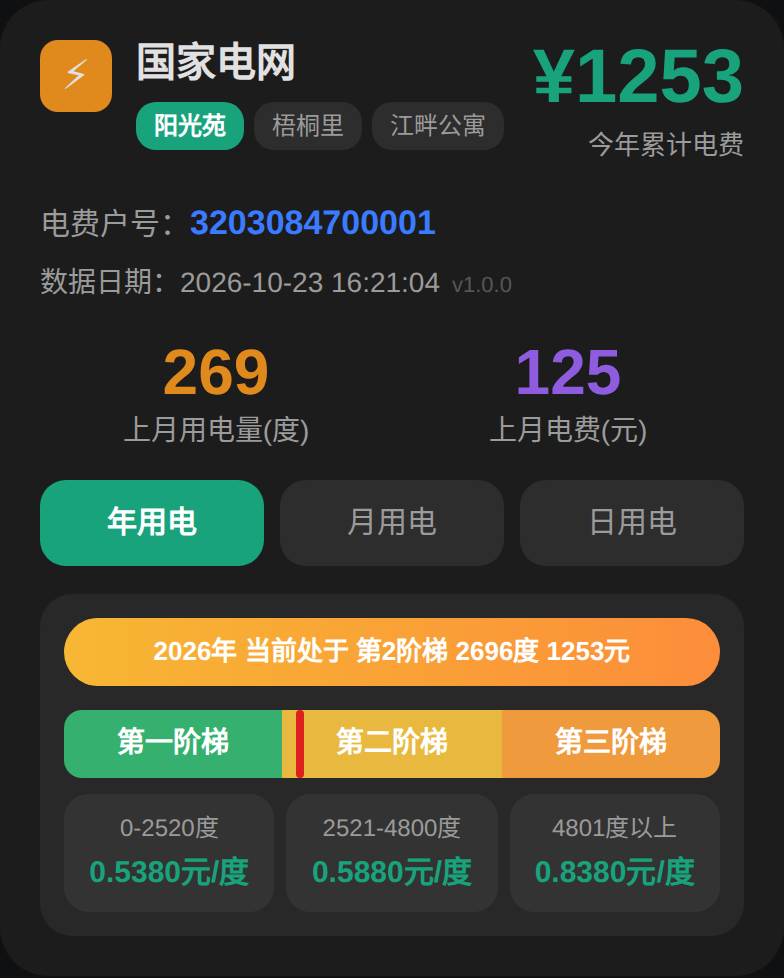
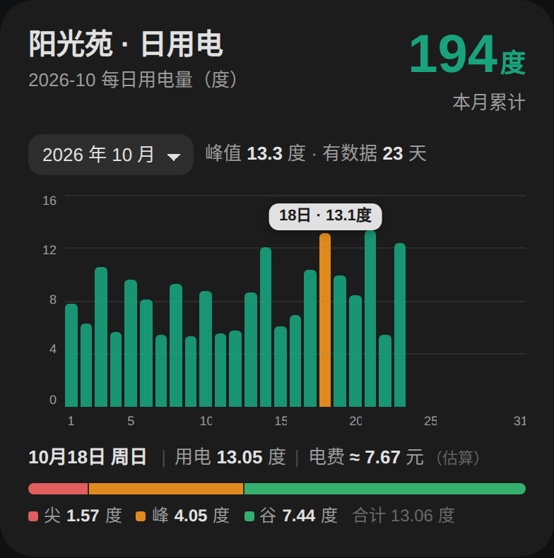

# 国家电网电费卡片（State Grid Electricity Card）

Home Assistant 自定义卡片，用于展示「网上国网」户号的电费概览与每日用电趋势。

> ## ⚠️ 前置条件（必读）
>
> **本卡片只是展示层，本身不获取任何数据。**
> 使用前必须先在 Home Assistant 中安装并配置国家电网集成：
>
> **👉 [stevenjoezhang/hass-state-grid](https://github.com/stevenjoezhang/hass-state-grid)**
>
> 并且等它成功抓取过一次数据（设置 → 设备与服务 → 国家电网 → 能看到传感器实体）。
> 未安装该集成时，卡片虽然能添加，但金额、电量会显示 `0` 或空白，趋势图无柱子。

## 功能

**概览卡片 `custom:elec-summary-card`**

- 多户号切换：点户号胶囊，卡片与趋势图同步切换
- 年 / 月 / 日 用电视图切换
- 阶梯电量判断与红线标记（0-2520 / 2521-4800 / 4801+）
- 深浅色自动跟随 Home Assistant 主题

**趋势图卡片 `custom:elec-chart-card`**

- 柱状图展示所选月份每天的用电量，X 轴 1 日到月末
- 左上角下拉框切换月份（选项来自集成实际抓取到的月份）
- 点击任意柱子：显示当天日期、星期、用电量、电费，以及尖/峰/平/谷分时段拆分
- 上游未返回日电费时，按阶梯电价分段估算（标注 `≈` 与「估算」）

## 安装

### 第 0 步：先装数据源

本卡片依赖 [hass-state-grid](https://github.com/stevenjoezhang/hass-state-grid) 集成。请先：

1. HACS → 集成 → 自定义存储库，添加 `https://github.com/stevenjoezhang/hass-state-grid`（类别：集成）
2. 下载后重启 HA
3. 设置 → 设备与服务 → 添加集成 → 搜索「国家电网」，输入网上国网手机号与密码
4. 等一次数据更新完成，确认 `sensor.*_current_year_charge` 等实体有值

完成后再安装本卡片。

### HACS（推荐）

1. HACS → 前端 → 右上角 ⋮ → **自定义存储库**
2. 填入本仓库地址:`https://github.com/hxf14789/State-Grid-Electricity-Card`，类别选择 **仪表盘**
3. 搜索「State Grid Electricity Card」→ 下载
4. 刷新页面（首次可能需要重启 HA 或强制刷新浏览器缓存）

### 手动安装

1. 下载 `dist/elec-dashboard.js`，放到 `/config/www/`
2. 设置 → 仪表盘 → ⋮ → 资源 → 添加 `/local/elec-dashboard.js`，类型选 **JavaScript 模块**

## 快速开始

先用下面这段最小配置，确认能出数据，再改成自己的户号：

```yaml
type: custom:elec-summary-card
accounts:
  - key: home_a          # 实体前缀，见下一节
    name: 我家           # 卡片上显示的名字，随便写
    number: "3203084700001"
```

---

## 适配你自己的实体（重点）

卡片不读固定实体名，它靠 **`key`（实体前缀）** 拼出 6 个实体 ID：

```
sensor.<key>_current_year_charge
sensor.<key>_current_year_usage
sensor.<key>_current_month_usage
sensor.<key>_previous_daily_usage
sensor.<key>_previous_settled_month_usage
sensor.<key>_previous_settled_month_charge
```

所以只要找出**这 6 个实体共有的那一段前缀**，填进 `key` 即可。

### 第 1 步：找到自己的实体 ID

1. 装好 [hass-state-grid](https://github.com/stevenjoezhang/hass-state-grid) 集成，等一次数据更新完成
2. 打开 **开发者工具 → 状态**（Developer Tools → States）
3. 在筛选框输入 `current_year_charge`

会看到类似这样的实体：

```
sensor.zhang_san_jia_current_year_charge
```

### 第 2 步：截出前缀

去掉开头的 `sensor.` 和结尾的 `_current_year_charge`，中间那段就是 `key`：

| 完整实体 ID | 提取出的 key |
|---|---|
| `sensor.home_a_current_year_charge` | `home_a` |
| `sensor.zhang_san_jia_current_year_charge` | `zhang_san_jia` |
| `sensor.1234567890_current_year_charge` | `1234567890` |

> ⚠️ 三个容易出错的地方：
> - **不要带 `sensor.`**，也不要带后面的 `_current_year_charge`
> - 全部小写、用下划线分隔（HA 实体 ID 规则）
> - 中文设备名会被转成拼音，例如「燕升园」→ `yan_sheng_yuan`

### 第 3 步：填进配置

```yaml
type: custom:elec-summary-card
accounts:
  - key: zhang_san_jia
    name: 我家
    number: "自己的14位户号"
```

```yaml
type: custom:elec-chart-card
accounts:
  - key: zhang_san_jia
    name: 我家
    number: "自己的14位户号"
```

两张卡片的 `accounts` 写成一样，就能联动切换。

### 多个户号

按顺序追加，每户一个 `key`：

```yaml
type: custom:elec-summary-card
accounts:
  - key: home_a
    name: 我家
    number: "3203084700001"
  - key: home_b
    name: 父母家
    number: "3205511000002"
  - key: home_c
    name: 出租房
    number: "3205400100003"
```

### 实体命名不统一怎么办

如果你改过实体 ID，或多户号前缀规则不一致（一个 `home_a_`、另一个 `wo_jia_`），用 `entities` 逐条指定，不再依赖前缀拼接：

```yaml
type: custom:elec-summary-card
accounts:
  - key: my_home          # 仅作唯一标识，不参与实体匹配
    name: 我家
    number: "3203084700001"
    entities:
      current_year_charge: sensor.wo_jia_nian_du_dian_fei
      current_year_usage: sensor.wo_jia_nian_du_yong_dian_liang
      current_month_usage: sensor.wo_jia_ben_yue_yong_dian
      previous_daily_usage: sensor.wo_jia_zuo_ri_yong_dian
      previous_settled_month_usage: sensor.wo_jia_shang_yue_dian_liang
      previous_settled_month_charge: sensor.wo_jia_shang_yue_dian_fei
```

`entities` 里没写的项，仍按 `sensor.<key>_<后缀>` 拼接。

### 第 4 步：自检

保存配置后，正常状态应是：

| 检查点 | 正常表现 | 异常时排查 |
|---|---|---|
| 右上角金额 | 显示 `¥xxxx`，不是 `¥0` | `key` 是否写错；实体是否 `unavailable` |
| 电费户号 | 显示 `number` 里填的号码 | — |
| 上月两项 | 有具体数值 | `previous_settled_month_*` 实体是否存在 |
| 阶梯气泡 | `第 N 阶梯 xxx 度` | `current_year_usage` 是否为数字 |
| 趋势图 | 有柱子，月份下拉框有选项 | `previous_daily_usage` 的 `daily_history` 属性是否有数据 |

如果金额显示 `¥0` 而实体明明有值，九成是 `key` 写错了。可以在配置里临时加 `debug: true`，卡片会打印实际读到的账户配置，逐字对照即可。

### 数据来源对照

| 卡片位置 | 实体后缀 | 说明 |
|---|---|---|
| 今年累计电费 | `current_year_charge` | 本年已结算电费累计 |
| 年用电、阶梯判断 | `current_year_usage` | 本年累计电量 |
| 本月用电 | `current_month_usage` | 本月累计电量 |
| 近日用电 | `previous_daily_usage` | 上游最新发布的一天 |
| 上月用电 / 电费 | `previous_settled_month_usage` / `_charge` | 上一个已出账月份 |
| 趋势图数据 | `previous_daily_usage` 的 `daily_history` 属性 | 集成缓存的每日记录 |

> 趋势图月份下拉框只显示 `daily_history` 里实际存在的月份。想查更早的月份，去集成配置把「查询最近几个月」调大（最多 3 个月）。

---

## 参数说明

| 参数 | 类型 | 必填 | 说明 |
|---|---|---|---|
| `accounts` | list | 是 | 户号列表 |
| `accounts[].key` | string | 是 | 实体前缀，或任意唯一标识（配合 `entities` 时） |
| `accounts[].name` | string | 是 | 卡片上显示的名字 |
| `accounts[].number` | string | 否 | 电费户号，纯展示 |
| `accounts[].entities` | map | 否 | 逐条覆盖实体 ID，键为后缀名 |
| `estimateCharge` | bool | 否 | 日电费缺失时是否按阶梯估算，默认 `true` |
| `debug` | bool | 否 | 在卡片内打印账户配置对象，排查用 |

## 已知限制

- 户号选择保存在浏览器 `localStorage`，同一浏览器内两张卡片共享；换设备后回到第一个户号
- 阶梯阈值固定为 2520 / 4800 度、电价 0.5380 / 0.5880 / 0.8380（居民合表口径），各省可能不同，需自行调整 `src/elec-dashboard.js` 中的 `tierCost` 与阶梯文案
- 分时段只在当地上游返回 `tip/peak/flat/valley` 时才有内容；峰谷两段制地区只会显示两段

## 效果图

### 浅色 / 深色主题

左右为同一份数据、同一个选中日期，仅主题不同：



### 概览卡片

年 / 月 / 日 切换、阶梯电量与红线标记：



### 趋势图

柱状图 + 月份下拉框，点击 18 日后的效果（浮动标签、当天用电与电费、尖峰谷分时段）：



## 许可

AGPL-3.0 license
